<div align="center">

# Game Design Codex (GDC)

**46 playable 3D WebGL2 mini-games that expose the hidden tricks behind video games — zero dependencies, zero build step.**

[**Play Live Codex ↗**](https://gamedevpl.github.io/gdc/) · [gamedev.pl](https://www.gamedev.pl) · [FX Lab](https://github.com/gamedevpl/fx-lab) · [YouTube](https://www.youtube.com/@gamedev_pl)


<br>

<a href="https://gamedevpl.github.io/gdc/">
  
</a>

*Flip any mechanic ON vs OFF while you play (`T`): feel 115 ms Coyote Time, Corner Correction, GGPO Rollback Netcode, GOAP Planning, Influence Maps, NavMesh Funnel String-Pulling, Structural Collapse, and Chunk Streaming firsthand.*

</div>

---

## Play & toggle the trick live

Every entry lets you disable the "invisible" game-design trick on the fly (`T`) so you can immediately feel why raw honest math often plays worse than carefully crafted illusions.

<p align="center">
  <a href="https://gamedevpl.github.io/gdc/">
    
  </a>
</p>

---

## All 46 playable entries

Click any card to play it in your browser — no login, no install.

### Game Feel & Camera (15)

<table>
  <tr>
    <td align="center" width="33%" valign="top">
      <a href="https://gamedevpl.github.io/gdc/recoil-patterns/">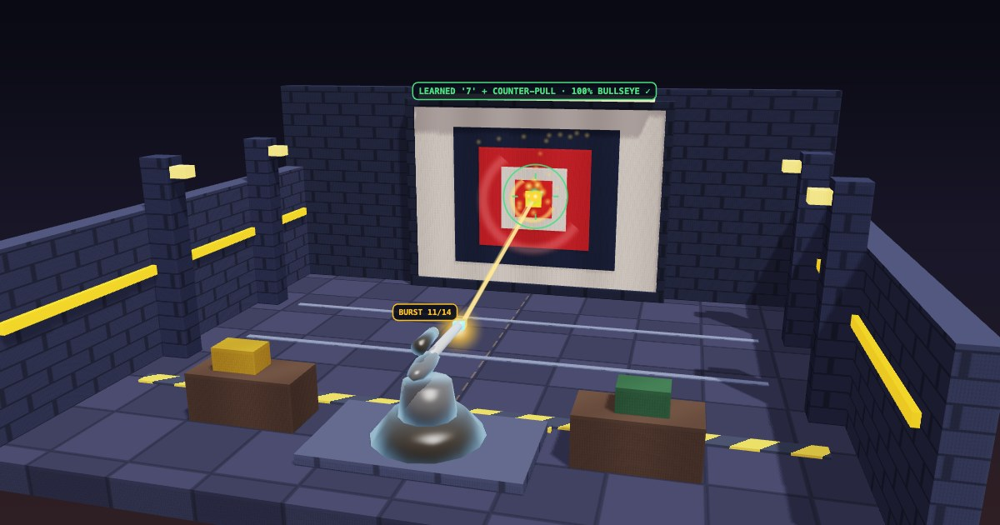</a><br>
      <b><a href="https://gamedevpl.github.io/gdc/recoil-patterns/">Recoil Patterns &amp; Spread</a></b><br>
      <sub>Learnable 7-shaped spray curve with counter-pull vs pure random RNG bloom.</sub><br>
      <sub><a href="./docs/src/entries/recoil-patterns/">Code</a></sub>
    </td>
    <td align="center" width="33%" valign="top">
      <a href="https://gamedevpl.github.io/gdc/ledge-mantle/">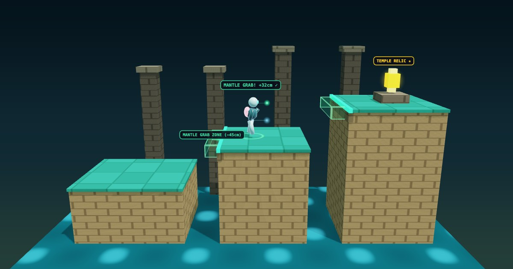</a><br>
      <b><a href="https://gamedevpl.github.io/gdc/ledge-mantle/">Ledge Grab &amp; Auto-Mantle</a></b><br>
      <sub>Chest-vs-head probes vault 30 cm short jumps onto rooftops vs falling short.</sub><br>
      <sub><a href="./docs/src/entries/ledge-mantle/">Code</a></sub>
    </td>
    <td align="center" width="33%" valign="top">
      <a href="https://gamedevpl.github.io/gdc/fixed-timestep/">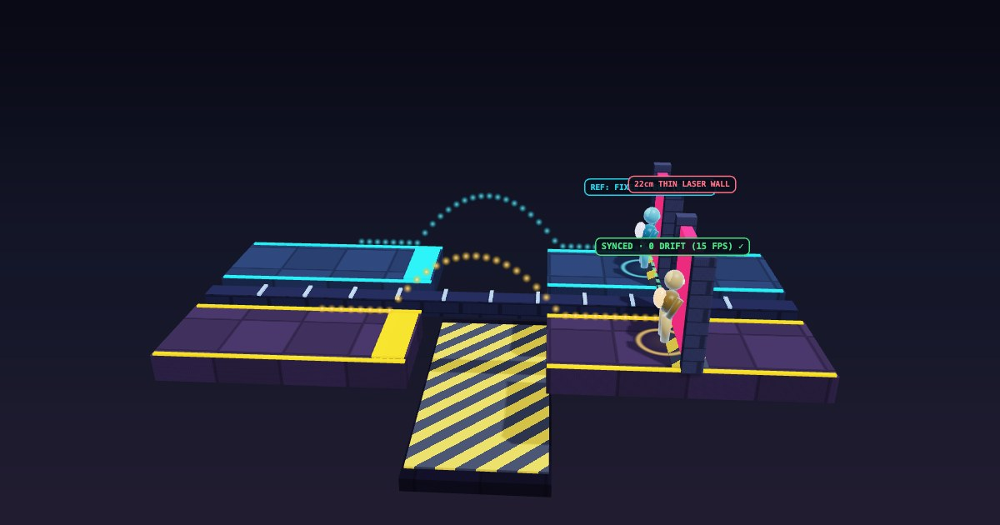</a><br>
      <b><a href="https://gamedevpl.github.io/gdc/fixed-timestep/">Fixed Timestep vs dt Bugs</a></b><br>
      <sub>1/60 s accumulator across 15–144 FPS vs raw frame-dt wall tunneling.</sub><br>
      <sub><a href="./docs/src/entries/fixed-timestep/">Code</a></sub>
    </td>
  </tr>
  <tr>
    <td align="center" width="33%" valign="top">
      <a href="https://gamedevpl.github.io/gdc/variable-jump/">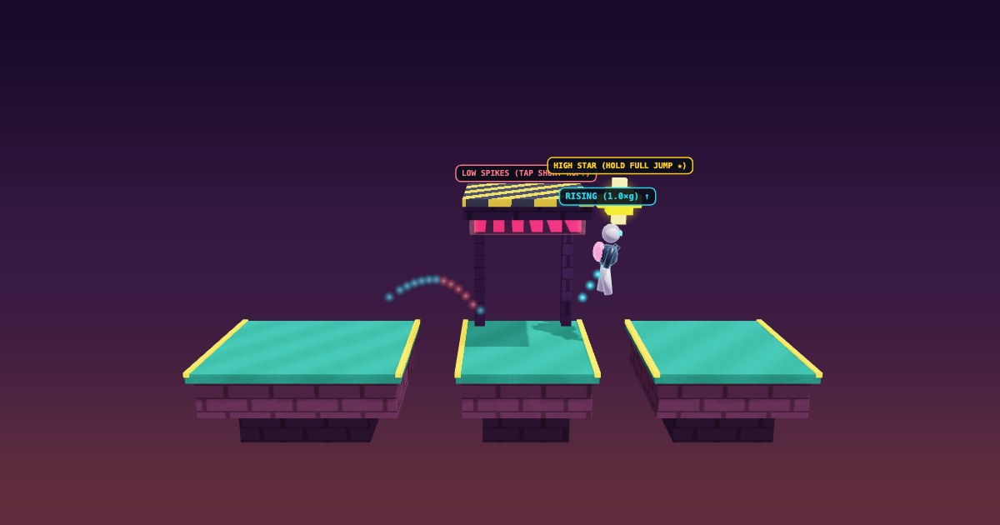</a><br>
      <b><a href="https://gamedevpl.github.io/gdc/variable-jump/">Variable Jump &amp; Apex Hang</a></b><br>
      <sub>Tap-to-cut jump height, 0.45× apex hang-time &amp; 1.9× heavy fall vs floaty parabola.</sub><br>
      <sub><a href="./docs/src/entries/variable-jump/">Code</a></sub>
    </td>
    <td align="center" width="33%" valign="top">
      <a href="https://gamedevpl.github.io/gdc/corner-correction/">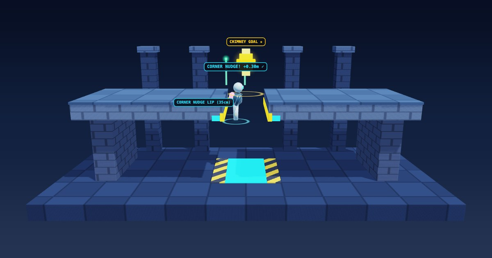</a><br>
      <b><a href="https://gamedevpl.github.io/gdc/corner-correction/">Corner Correction (Nudge)</a></b><br>
      <sub>Secretly slide past a 2-pixel ceiling lip like Celeste &amp; Mario vs hard head-bonk.</sub><br>
      <sub><a href="./docs/src/entries/corner-correction/">Code</a></sub>
    </td>
    <td align="center" width="33%" valign="top">
      <a href="https://gamedevpl.github.io/gdc/step-up-slopes/">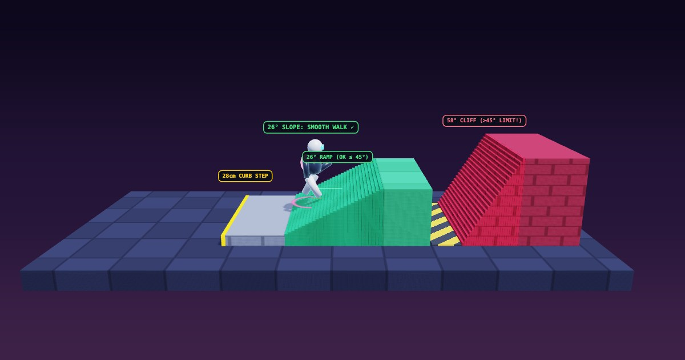</a><br>
      <b><a href="https://gamedevpl.github.io/gdc/step-up-slopes/">Step-Up &amp; Slope Limits</a></b><br>
      <sub>Auto-climb 28 cm curbs, walk 26° ramps, and slide off 58° cliffs (&gt;45° cap).</sub><br>
      <sub><a href="./docs/src/entries/step-up-slopes/">Code</a></sub>
    </td>
  </tr>
  <tr>
    <td align="center" width="33%" valign="top">
      <a href="https://gamedevpl.github.io/gdc/ik-foot-placement/">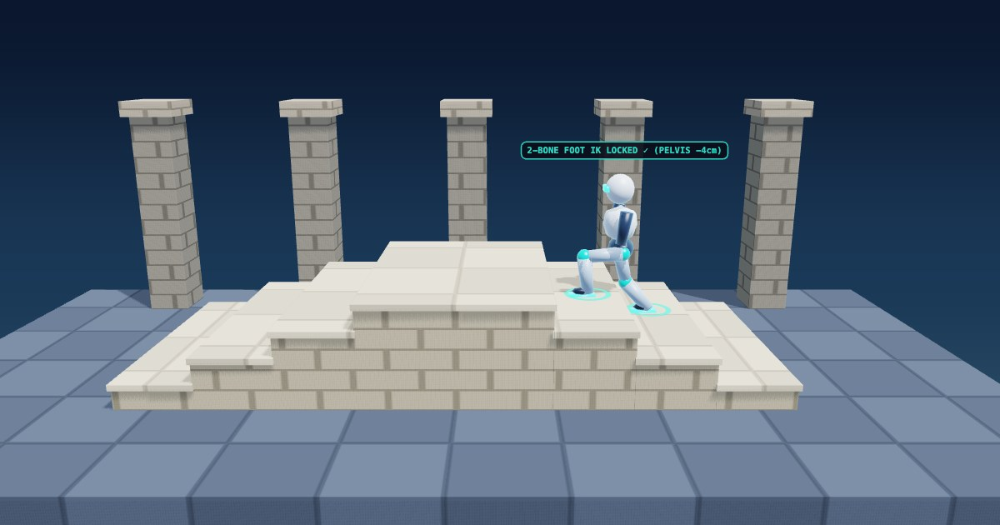</a><br>
      <b><a href="https://gamedevpl.github.io/gdc/ik-foot-placement/">2-Bone Foot IK on Stairs</a></b><br>
      <sub>Analytical Law-of-Cosines IK locks boots flush on steps vs rigid clipping &amp; floating.</sub><br>
      <sub><a href="./docs/src/entries/ik-foot-placement/">Code</a></sub>
    </td>
    <td align="center" width="33%" valign="top">
      <a href="https://gamedevpl.github.io/gdc/camera-spring-arm/">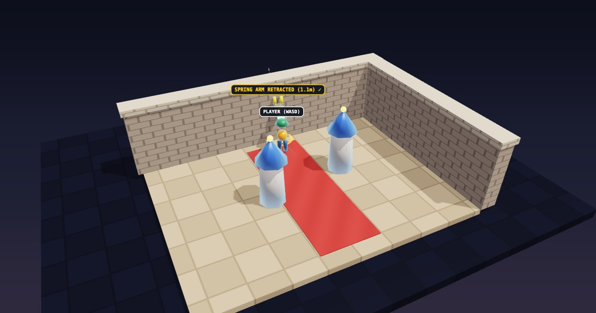</a><br>
      <b><a href="https://gamedevpl.github.io/gdc/camera-spring-arm/">Camera Spring Arm</a></b><br>
      <sub>Why 3rd-person cameras pull in smoothly &amp; fade pillars instead of clipping walls.</sub><br>
      <sub><a href="./docs/src/entries/camera-spring-arm/">Code</a></sub>
    </td>
    <td align="center" width="33%" valign="top">
      <a href="https://gamedevpl.github.io/gdc/animation-cancel/"></a><br>
      <b><a href="https://gamedevpl.github.io/gdc/animation-cancel/">Frame Data &amp; Cancel</a></b><br>
      <sub>Startup → Active → Recovery frames, and slicing 420 ms off with Dodge-Cancel.</sub><br>
      <sub><a href="./docs/src/entries/animation-cancel/">Code</a></sub>
    </td>
  </tr>
  <tr>
    <td align="center" width="33%" valign="top">
      <a href="https://gamedevpl.github.io/gdc/hitboxes-iframes/">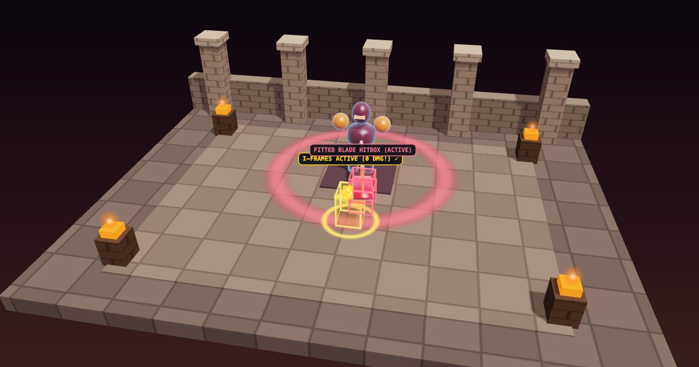</a><br>
      <b><a href="https://gamedevpl.github.io/gdc/hitboxes-iframes/">Hitboxes &amp; I-Frames</a></b><br>
      <sub>Roll straight through a boss halberd with 280 ms golden Invincibility Frames.</sub><br>
      <sub><a href="./docs/src/entries/hitboxes-iframes/">Code</a></sub>
    </td>
    <td align="center" width="33%" valign="top">
      <a href="https://gamedevpl.github.io/gdc/bullet-magnetism/"></a><br>
      <b><a href="https://gamedevpl.github.io/gdc/bullet-magnetism/">Bullet Magnetism</a></b><br>
      <sub>Why Halo &amp; Destiny shots land when you miss: ±7.5° mid-air curving vs Raw 0°.</sub><br>
      <sub><a href="./docs/src/entries/bullet-magnetism/">Code</a></sub>
    </td>
    <td align="center" width="33%" valign="top">
      <a href="https://gamedevpl.github.io/gdc/camera-deadzone/"></a><br>
      <b><a href="https://gamedevpl.github.io/gdc/camera-deadzone/">Camera Deadzone</a></b><br>
      <sub>Compare a smart deadzone + look-ahead box against a jittery locked camera.</sub><br>
      <sub><a href="./docs/src/entries/camera-deadzone/">Code</a></sub>
    </td>
  </tr>
  <tr>
    <td align="center" width="33%" valign="top">
      <a href="https://gamedevpl.github.io/gdc/fake-1hp/">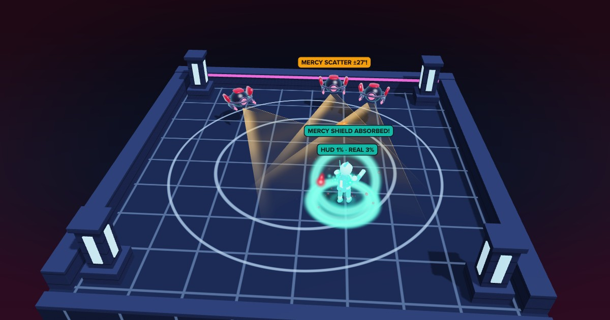</a><br>
      <b><a href="https://gamedevpl.github.io/gdc/fake-1hp/">Fake 1 HP &amp; Death's Door</a></b><br>
      <sub>Hidden bottom-of-bar HP, lethal 1 HP clamps &amp; mercy enemy aim scatter.</sub><br>
      <sub><a href="./docs/src/entries/fake-1hp/">Code</a></sub>
    </td>
    <td align="center" width="33%" valign="top">
      <a href="https://gamedevpl.github.io/gdc/hitstop/">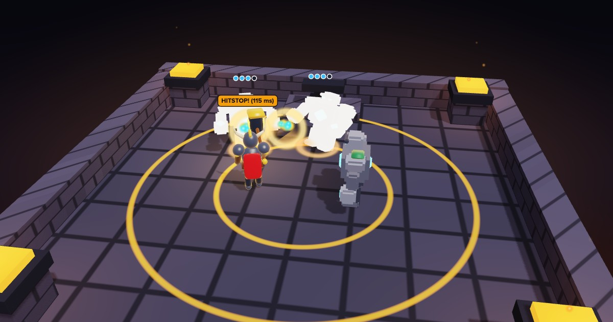</a><br>
      <b><a href="https://gamedevpl.github.io/gdc/hitstop/">Hitstop &amp; Game Juice</a></b><br>
      <sub>Smash golems and feel why a 60 ms freeze makes hits 10× heavier.</sub><br>
      <sub><a href="./docs/src/entries/hitstop/">Code</a></sub>
    </td>
    <td align="center" width="33%" valign="top">
      <a href="https://gamedevpl.github.io/gdc/coyote-time/"></a><br>
      <b><a href="https://gamedevpl.github.io/gdc/coyote-time/">Coyote Time &amp; Buffering</a></b><br>
      <sub>Feel why 115 ms invisible ledges &amp; jump buffers make platforming fair.</sub><br>
      <sub><a href="./docs/src/entries/coyote-time/">Code</a></sub>
    </td>
  </tr>
</table>

### World & Systems (12)

<table>
  <tr>
    <td align="center" width="33%" valign="top">
      <a href="https://gamedevpl.github.io/gdc/chunk-streaming/">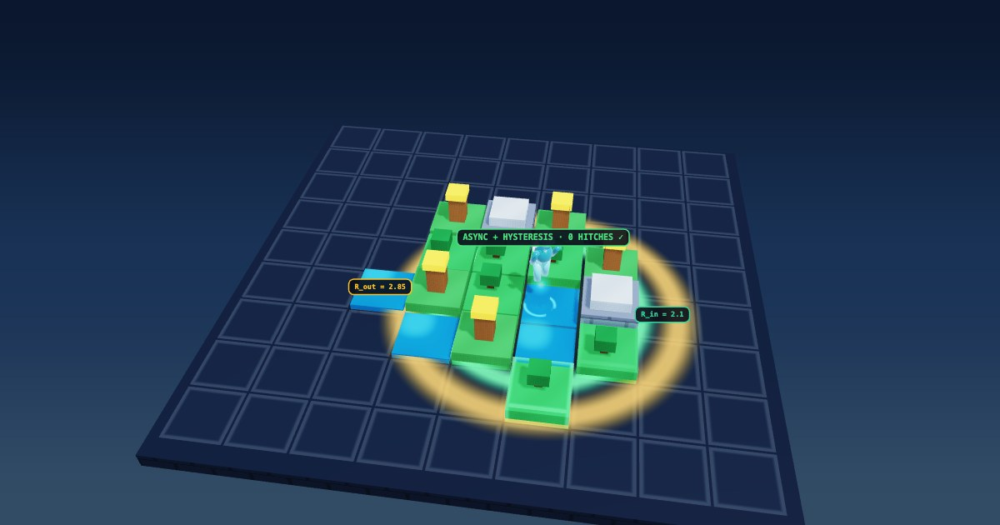</a><br>
      <b><a href="https://gamedevpl.github.io/gdc/chunk-streaming/">Chunk Streaming &amp; Hysteresis</a></b><br>
      <sub>Inner load + outer unload buffer rings prevent border thrashing &amp; 48 ms hitches.</sub><br>
      <sub><a href="./docs/src/entries/chunk-streaming/">Code</a></sub>
    </td>
    <td align="center" width="33%" valign="top">
      <a href="https://gamedevpl.github.io/gdc/structural-collapse/">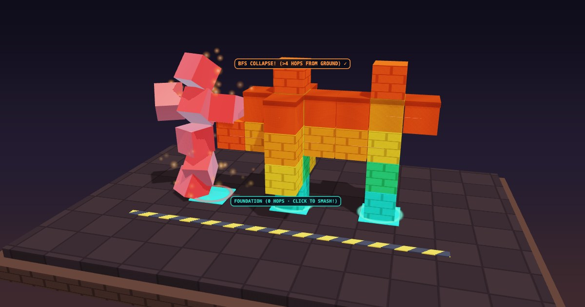</a><br>
      <b><a href="https://gamedevpl.github.io/gdc/structural-collapse/">Structural Collapse Graph</a></b><br>
      <sub>BFS integrity hops from grounded foundations collapse unsupported tower wings.</sub><br>
      <sub><a href="./docs/src/entries/structural-collapse/">Code</a></sub>
    </td>
    <td align="center" width="33%" valign="top">
      <a href="https://gamedevpl.github.io/gdc/snapshot-interpolation/">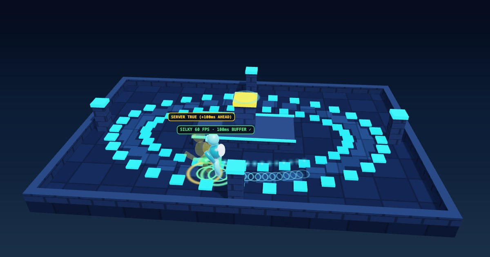</a><br>
      <b><a href="https://gamedevpl.github.io/gdc/snapshot-interpolation/">Snapshot Interpolation</a></b><br>
      <sub>Turn jittery 20 Hz server snapshots into silky 60 FPS motion with a 100 ms buffer.</sub><br>
      <sub><a href="./docs/src/entries/snapshot-interpolation/">Code</a></sub>
    </td>
  </tr>
  <tr>
    <td align="center" width="33%" valign="top">
      <a href="https://gamedevpl.github.io/gdc/rollback-netcode/">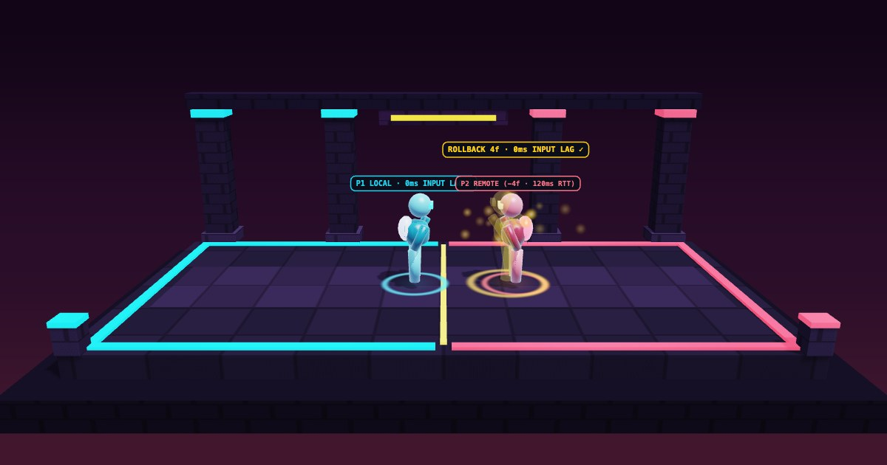</a><br>
      <b><a href="https://gamedevpl.github.io/gdc/rollback-netcode/">Rollback Netcode (GGPO)</a></b><br>
      <sub>0 ms input lag at 120 ms ping + visible 4-frame rewind ghosts vs delay netcode.</sub><br>
      <sub><a href="./docs/src/entries/rollback-netcode/">Code</a></sub>
    </td>
    <td align="center" width="33%" valign="top">
      <a href="https://gamedevpl.github.io/gdc/object-pooling/">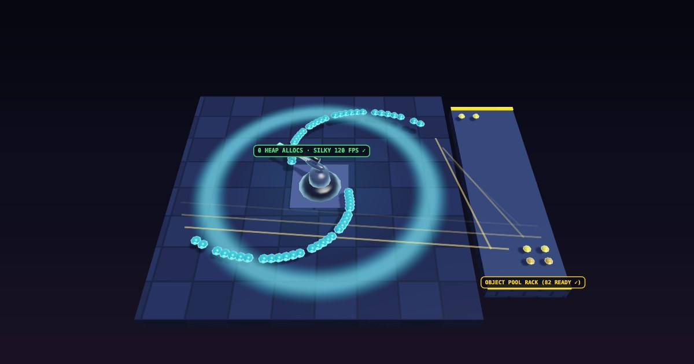</a><br>
      <b><a href="https://gamedevpl.github.io/gdc/object-pooling/">Object Pooling vs GC</a></b><br>
      <sub>Recycle a pre-allocated bullet pool (flat 8.3 ms) vs 195 ms GC freeze spikes.</sub><br>
      <sub><a href="./docs/src/entries/object-pooling/">Code</a></sub>
    </td>
    <td align="center" width="33%" valign="top">
      <a href="https://gamedevpl.github.io/gdc/lod-billboards/">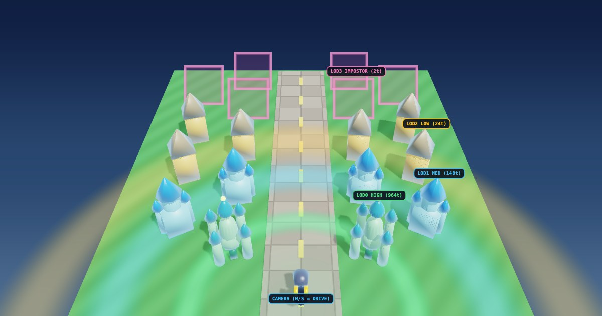</a><br>
      <b><a href="https://gamedevpl.github.io/gdc/lod-billboards/">Level of Detail (LOD)</a></b><br>
      <sub>Swap distant castles across 4 real tiers (964 → 148 → 24 → 2-tri billboards).</sub><br>
      <sub><a href="./docs/src/entries/lod-billboards/">Code</a></sub>
    </td>
  </tr>
  <tr>
    <td align="center" width="33%" valign="top">
      <a href="https://gamedevpl.github.io/gdc/client-prediction/">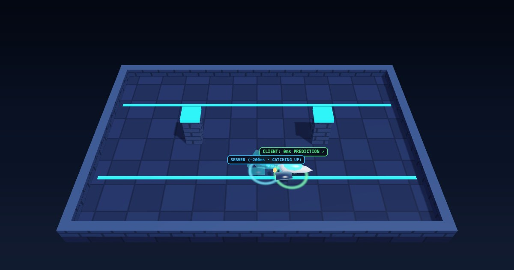</a><br>
      <b><a href="https://gamedevpl.github.io/gdc/client-prediction/">Client Prediction &amp; Replay</a></b><br>
      <sub>0 ms local movement at 200 ms ping + input buffer replay after a server desync.</sub><br>
      <sub><a href="./docs/src/entries/client-prediction/">Code</a></sub>
    </td>
    <td align="center" width="33%" valign="top">
      <a href="https://gamedevpl.github.io/gdc/frustum-culling/"></a><br>
      <b><a href="https://gamedevpl.github.io/gdc/frustum-culling/">Frustum &amp; Occlusion Culling</a></b><br>
      <sub>See how your GPU drops everything outside the 62° camera cone &amp; behind walls.</sub><br>
      <sub><a href="./docs/src/entries/frustum-culling/">Code</a></sub>
    </td>
    <td align="center" width="33%" valign="top">
      <a href="https://gamedevpl.github.io/gdc/wfc-island/"></a><br>
      <b><a href="https://gamedevpl.github.io/gdc/wfc-island/">Wave Function Collapse</a></b><br>
      <sub>Build seamless 3D islands tile-by-tile with lowest-entropy constraint propagation.</sub><br>
      <sub><a href="./docs/src/entries/wfc-island/">Code</a></sub>
    </td>
  </tr>
  <tr>
    <td align="center" width="33%" valign="top">
      <a href="https://gamedevpl.github.io/gdc/lag-compensation/"></a><br>
      <b><a href="https://gamedevpl.github.io/gdc/lag-compensation/">Lag Compensation &amp; Rewind</a></b><br>
      <sub>Why sniper shots land at 180 ms ping — and why you sometimes die "behind a wall".</sub><br>
      <sub><a href="./docs/src/entries/lag-compensation/">Code</a></sub>
    </td>
    <td align="center" width="33%" valign="top">
      <a href="https://gamedevpl.github.io/gdc/pity-timer/">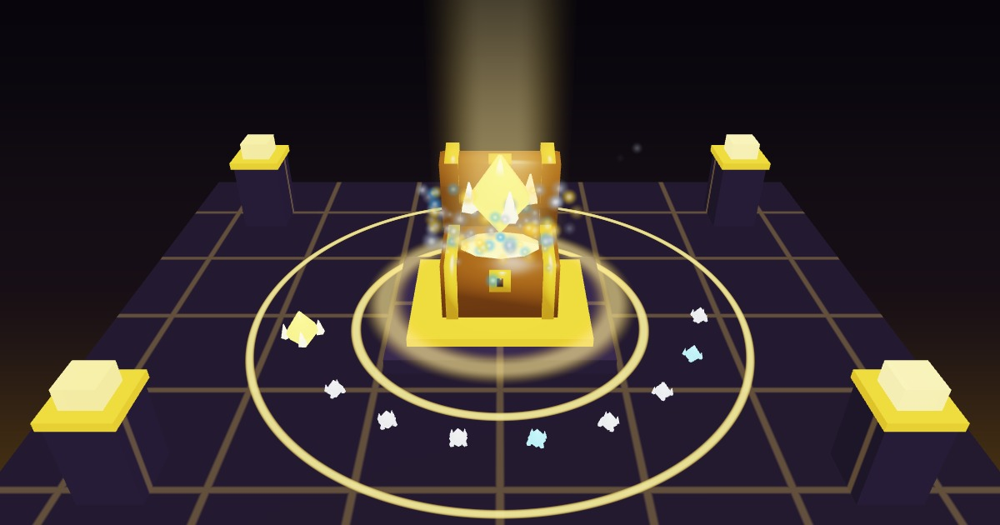</a><br>
      <b><a href="https://gamedevpl.github.io/gdc/pity-timer/">Pity Timer &amp; PRD Drops</a></b><br>
      <sub>Race True 10% RNG against Hidden Pity + PRD side by side off the same seed.</sub><br>
      <sub><a href="./docs/src/entries/pity-timer/">Code</a></sub>
    </td>
    <td align="center" width="33%" valign="top">
      <a href="https://gamedevpl.github.io/gdc/bsp-dungeon/">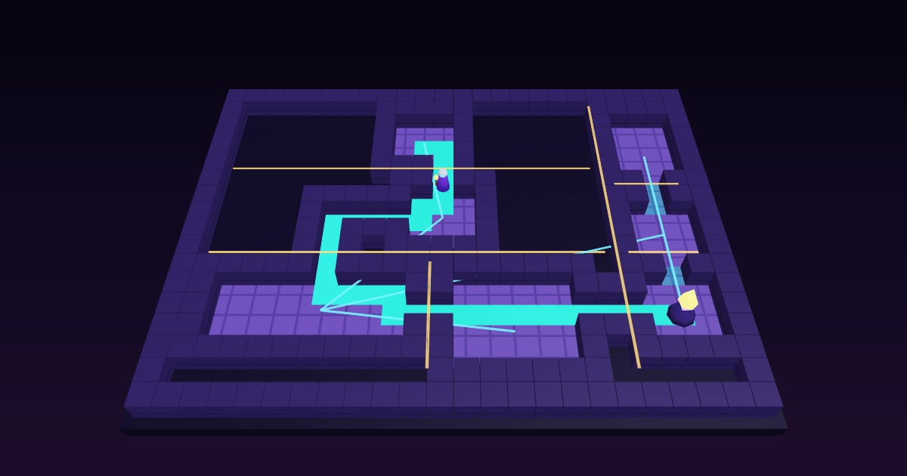</a><br>
      <b><a href="https://gamedevpl.github.io/gdc/bsp-dungeon/">Procedural Dungeon (BSP)</a></b><br>
      <sub>Roll 3D roguelike dungeons that never trap the player vs broken random placement.</sub><br>
      <sub><a href="./docs/src/entries/bsp-dungeon/">Code</a></sub>
    </td>
  </tr>
</table>

### Enemy & Race AI (10)

<table>
  <tr>
    <td align="center" width="33%" valign="top">
      <a href="https://gamedevpl.github.io/gdc/sound-propagation/">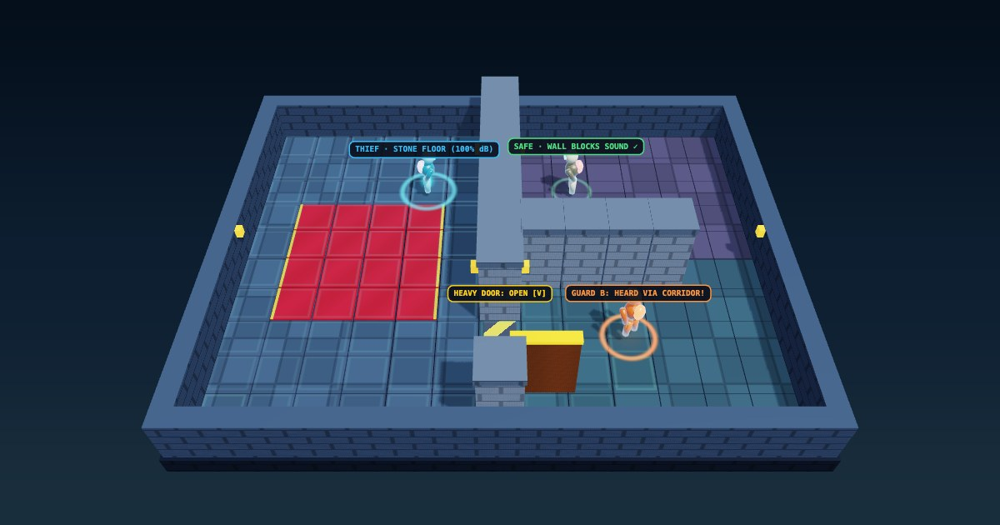</a><br>
      <b><a href="https://gamedevpl.github.io/gdc/sound-propagation/">Sound Propagation Acoustics</a></b><br>
      <sub>BFS sound waves bend through doorways &amp; fade on carpet vs wall-piercing circles.</sub><br>
      <sub><a href="./docs/src/entries/sound-propagation/">Code</a></sub>
    </td>
    <td align="center" width="33%" valign="top">
      <a href="https://gamedevpl.github.io/gdc/offscreen-courtesy/">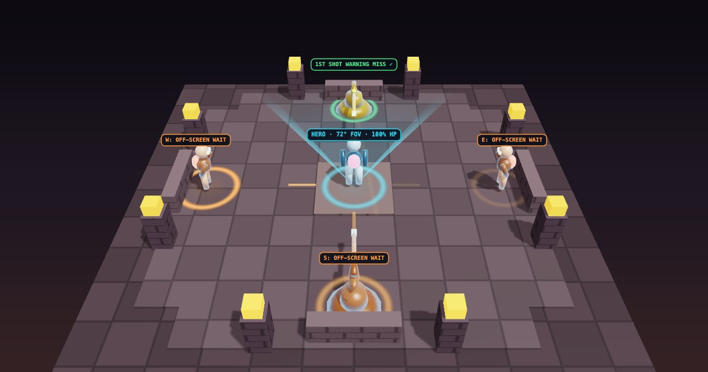</a><br>
      <b><a href="https://gamedevpl.github.io/gdc/offscreen-courtesy/">Off-Screen AI &amp; 1st-Shot Miss</a></b><br>
      <sub>BioShock &amp; Doom warning misses + off-screen courtesy vs instant backstabs.</sub><br>
      <sub><a href="./docs/src/entries/offscreen-courtesy/">Code</a></sub>
    </td>
    <td align="center" width="33%" valign="top">
      <a href="https://gamedevpl.github.io/gdc/influence-maps/">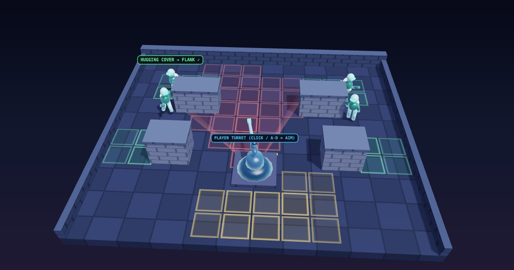</a><br>
      <b><a href="https://gamedevpl.github.io/gdc/influence-maps/">Influence Maps &amp; Flanking</a></b><br>
      <sub>3D threat/cover/flank heatmap guides raiders behind walls instead of into fire.</sub><br>
      <sub><a href="./docs/src/entries/influence-maps/">Code</a></sub>
    </td>
  </tr>
  <tr>
    <td align="center" width="33%" valign="top">
      <a href="https://gamedevpl.github.io/gdc/goap-planner/">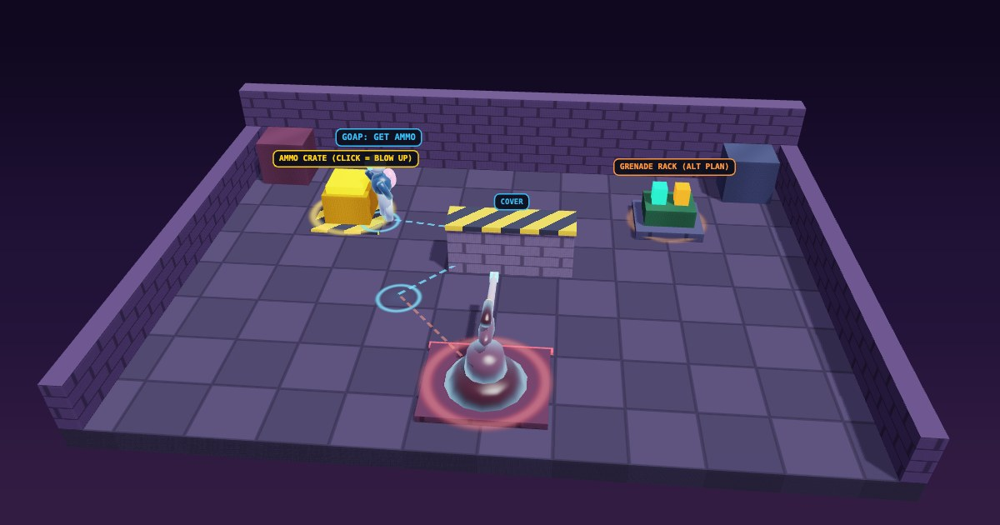</a><br>
      <b><a href="https://gamedevpl.github.io/gdc/goap-planner/">GOAP Action Planning</a></b><br>
      <sub>Blow up the ammo crate and watch F.E.A.R.-style AI invent a grenade backup plan.</sub><br>
      <sub><a href="./docs/src/entries/goap-planner/">Code</a></sub>
    </td>
    <td align="center" width="33%" valign="top">
      <a href="https://gamedevpl.github.io/gdc/behavior-trees/">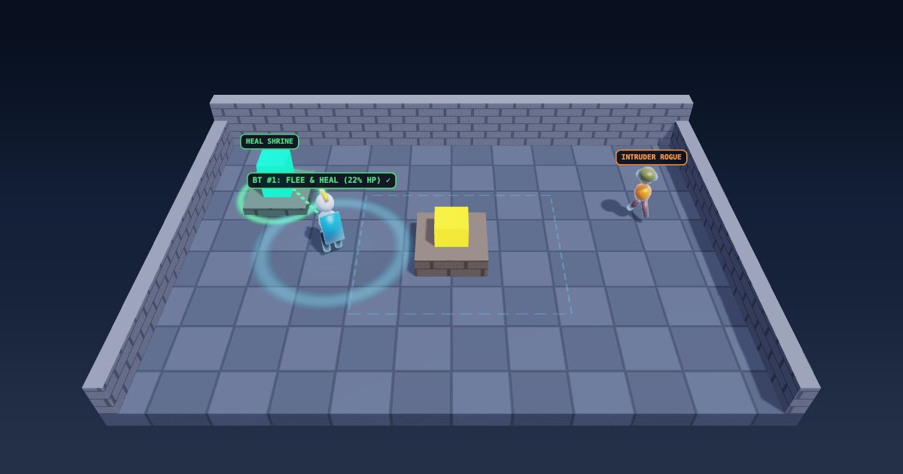</a><br>
      <b><a href="https://gamedevpl.github.io/gdc/behavior-trees/">Behavior Trees vs FSM</a></b><br>
      <sub>Live priority Selector tree graph preempting Chase to Heal vs fragile FSM deadlock.</sub><br>
      <sub><a href="./docs/src/entries/behavior-trees/">Code</a></sub>
    </td>
    <td align="center" width="33%" valign="top">
      <a href="https://gamedevpl.github.io/gdc/utility-ai/">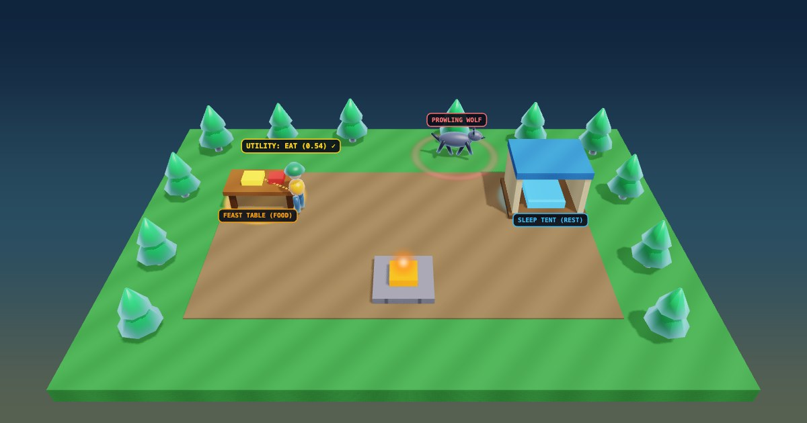</a><br>
      <b><a href="https://gamedevpl.github.io/gdc/utility-ai/">Utility AI (NPC Needs)</a></b><br>
      <sub>How NPCs balance Hunger, Sleep &amp; Wolf Danger with Utility Curves + Hysteresis.</sub><br>
      <sub><a href="./docs/src/entries/utility-ai/">Code</a></sub>
    </td>
  </tr>
  <tr>
    <td align="center" width="33%" valign="top">
      <a href="https://gamedevpl.github.io/gdc/ai-director/"></a><br>
      <b><a href="https://gamedevpl.github.io/gdc/ai-director/">AI Director (L4D Pacing)</a></b><br>
      <sub>Build-Up → Peak → Relax intensity curves &amp; mercy medkits vs constant spawns.</sub><br>
      <sub><a href="./docs/src/entries/ai-director/">Code</a></sub>
    </td>
    <td align="center" width="33%" valign="top">
      <a href="https://gamedevpl.github.io/gdc/stealth-cones/"></a><br>
      <b><a href="https://gamedevpl.github.io/gdc/stealth-cones/">Stealth Vision Cones (? → !)</a></b><br>
      <sub>65° raycasted cones, fill bars &amp; distraction coins vs realistic 140° instant spot.</sub><br>
      <sub><a href="./docs/src/entries/stealth-cones/">Code</a></sub>
    </td>
    <td align="center" width="33%" valign="top">
      <a href="https://gamedevpl.github.io/gdc/rubber-banding/">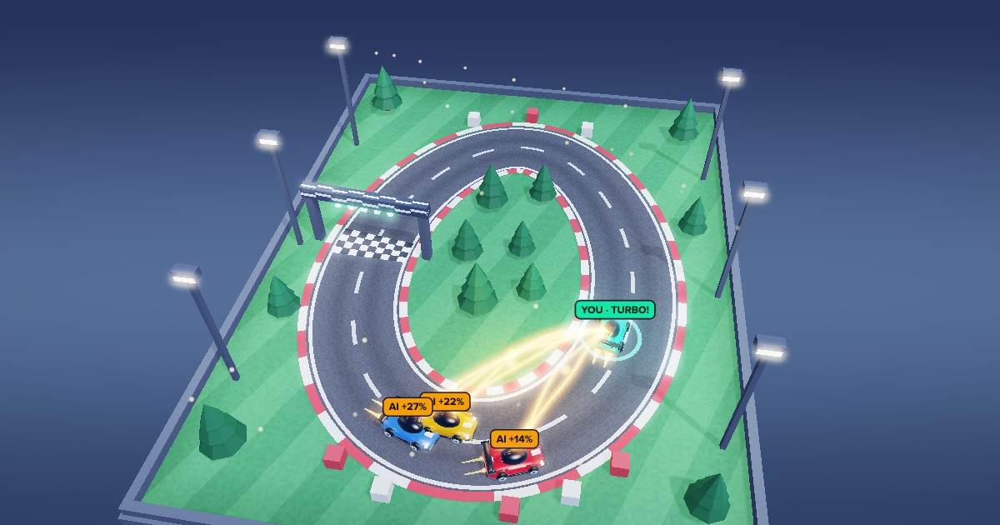</a><br>
      <b><a href="https://gamedevpl.github.io/gdc/rubber-banding/">Rubber Banding</a></b><br>
      <sub>Drive the Figure-8 overpass GP track and feel rival speed stretch like a tether.</sub><br>
      <sub><a href="./docs/src/entries/rubber-banding/">Code</a></sub>
    </td>
  </tr>
  <tr>
    <td align="center" width="33%" valign="top">
      <a href="https://gamedevpl.github.io/gdc/attack-tokens/"></a><br>
      <b><a href="https://gamedevpl.github.io/gdc/attack-tokens/">Attack Tokens</a></b><br>
      <sub>Fight 5 skeletons: polite turns with 1 Token vs instant dogpile with Tokens OFF.</sub><br>
      <sub><a href="./docs/src/entries/attack-tokens/">Code</a></sub>
    </td>
    <td colspan="2" align="center" valign="middle">
      <sub><b>Tip:</b> Press <code>T</code> inside any mini-game to switch between the real game-dev trick and the "honest" naive version — or hit <code>[</code> / <code>]</code> to step through all 46.</sub>
    </td>
  </tr>
</table>

### Pathfinding & Crowds (9)

<table>
  <tr>
    <td align="center" width="33%" valign="top">
      <a href="https://gamedevpl.github.io/gdc/jump-point-search/">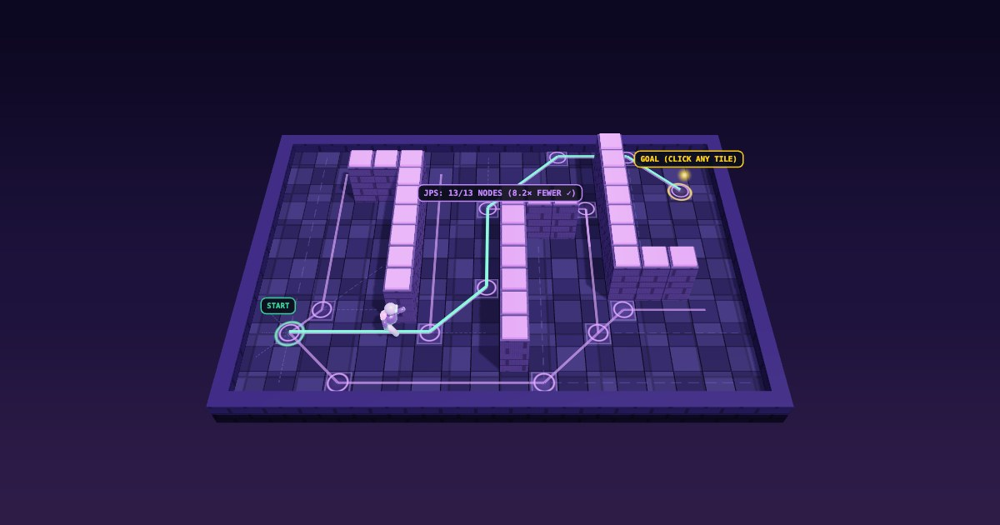</a><br>
      <b><a href="https://gamedevpl.github.io/gdc/jump-point-search/">Jump Point Search (JPS)</a></b><br>
      <sub>Leap straight across open rooms in 10× fewer expanded nodes than classic A*.</sub><br>
      <sub><a href="./docs/src/entries/jump-point-search/">Code</a></sub>
    </td>
    <td align="center" width="33%" valign="top">
      <a href="https://gamedevpl.github.io/gdc/formation-slots/">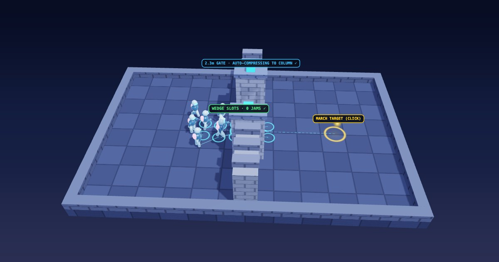</a><br>
      <b><a href="https://gamedevpl.github.io/gdc/formation-slots/">Formation Slots (RTS)</a></b><br>
      <sub>Wedge/Phalanx slots squeeze through narrow castle gates without blob jamming.</sub><br>
      <sub><a href="./docs/src/entries/formation-slots/">Code</a></sub>
    </td>
    <td align="center" width="33%" valign="top">
      <a href="https://gamedevpl.github.io/gdc/navmesh-funnel/">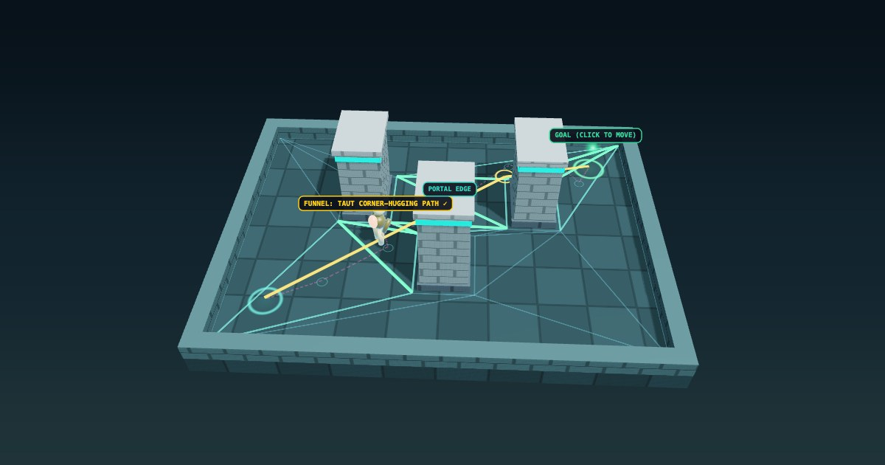</a><br>
      <b><a href="https://gamedevpl.github.io/gdc/navmesh-funnel/">NavMesh &amp; Funnel Pulling</a></b><br>
      <sub>Pull a taut path tight around pillar corners instead of zig-zagging centroids.</sub><br>
      <sub><a href="./docs/src/entries/navmesh-funnel/">Code</a></sub>
    </td>
  </tr>
  <tr>
    <td align="center" width="33%" valign="top">
      <a href="https://gamedevpl.github.io/gdc/steering-avoidance/">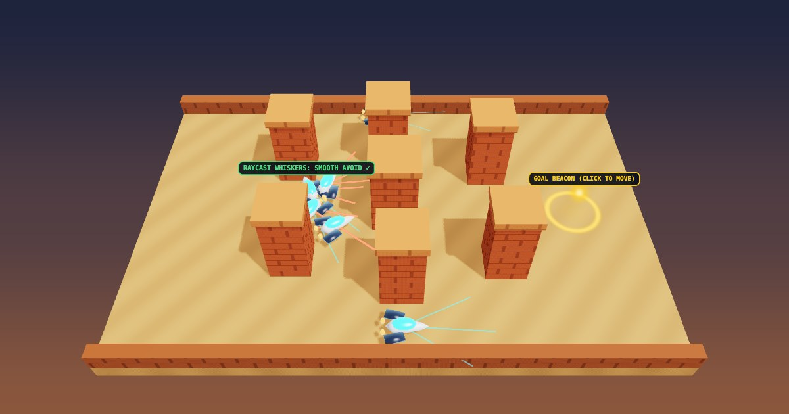</a><br>
      <b><a href="https://gamedevpl.github.io/gdc/steering-avoidance/">Steering &amp; Whisker Avoid</a></b><br>
      <sub>6 hover-skiffs carve through sandstone pillars using 3 raycast feelers vs blind Seek.</sub><br>
      <sub><a href="./docs/src/entries/steering-avoidance/">Code</a></sub>
    </td>
    <td align="center" width="33%" valign="top">
      <a href="https://gamedevpl.github.io/gdc/fog-of-war/">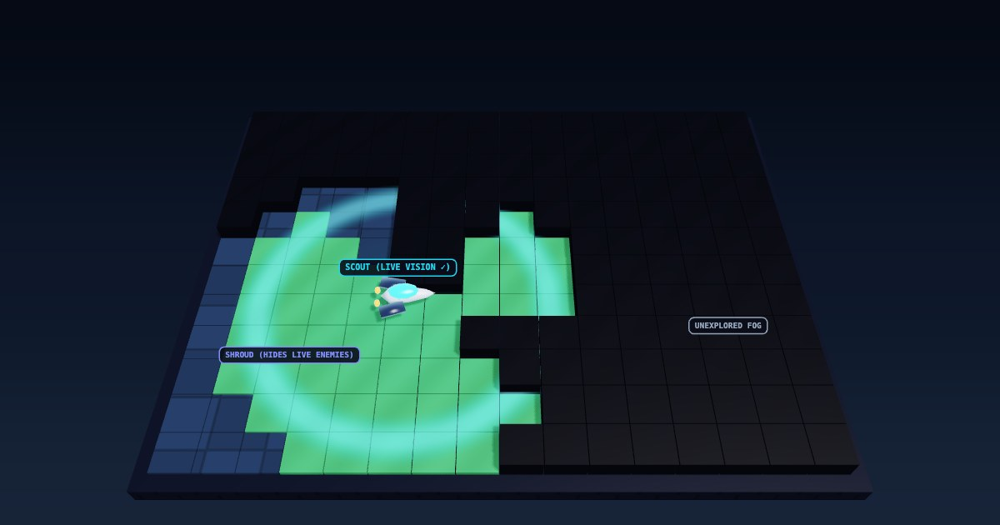</a><br>
      <b><a href="https://gamedevpl.github.io/gdc/fog-of-war/">Fog of War &amp; RTS Vision</a></b><br>
      <sub>3-state visibility: Pitch Fog → Shroud memory → raycasted Live Vision behind ridges.</sub><br>
      <sub><a href="./docs/src/entries/fog-of-war/">Code</a></sub>
    </td>
    <td align="center" width="33%" valign="top">
      <a href="https://gamedevpl.github.io/gdc/quadtree-collisions/"></a><br>
      <b><a href="https://gamedevpl.github.io/gdc/quadtree-collisions/">Quadtree &amp; Spatial Hashing</a></b><br>
      <sub>Handle 96+ live collisions by recursively splitting quadrants instead of O(n²) pairs.</sub><br>
      <sub><a href="./docs/src/entries/quadtree-collisions/">Code</a></sub>
    </td>
  </tr>
  <tr>
    <td align="center" width="33%" valign="top">
      <a href="https://gamedevpl.github.io/gdc/flow-field/">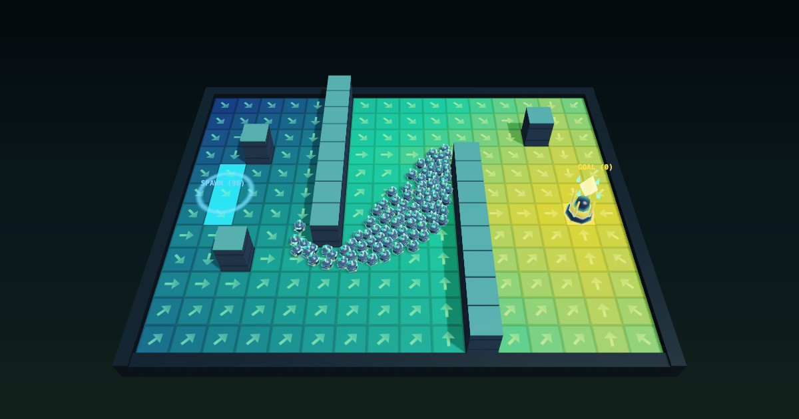</a><br>
      <b><a href="https://gamedevpl.github.io/gdc/flow-field/">Flow Field &amp; NavMesh</a></b><br>
      <sub>Steer 96 hover-bots around walls you paint live using one O(grid) vector field.</sub><br>
      <sub><a href="./docs/src/entries/flow-field/">Code</a></sub>
    </td>
    <td align="center" width="33%" valign="top">
      <a href="https://gamedevpl.github.io/gdc/boids-flocking/"></a><br>
      <b><a href="https://gamedevpl.github.io/gdc/boids-flocking/">Boids &amp; Flocking</a></b><br>
      <sub>72 reef fish with zero leader — toggle Separation, Alignment &amp; Cohesion live.</sub><br>
      <sub><a href="./docs/src/entries/boids-flocking/">Code</a></sub>
    </td>
    <td align="center" width="33%" valign="top">
      <a href="https://gamedevpl.github.io/gdc/astar/"></a><br>
      <b><a href="https://gamedevpl.github.io/gdc/astar/">A* Pathfinding</a></b><br>
      <sub>Drag to paint 3D maze walls live while distance numbers recalculate instantly.</sub><br>
      <sub><a href="./docs/src/entries/astar/">Code</a></sub>
    </td>
  </tr>
</table>

---

## Controls

| Input | Action |
| --- | --- |
| **`WASD` / Arrows** | Move, drive, run, or steer |
| **`Space` / Left-Click** | Primary action (jump, attack, fire, nitro, paint walls, smash blocks) |
| **`T`** | Toggle the mechanic ON vs OFF (strict vs fair, raw vs assisted) |
| **`X`** / **`V`** | X-Ray debug overlay / instant edge-case test |
| **`[` / `]`** | Previous / next diorama across all 46 |
| **Right-Drag / Scroll** | Orbit 3D diorama / zoom |
| **`P`** · **`R`** · **`M`/`B`** | Pause · reset · SFX / ambient audio |

---

## Running locally

Plain ES modules and raw WebGL2 inside `docs/` — no build step required:

```sh
python3 -m http.server 8092 --directory docs
```

Then open <http://localhost:8092/>. Append `?hud=0` for clean recording capture or `?lang=pl` for Polish.

---

## More interactive labs from [gamedev.pl](https://www.gamedev.pl)

- **[FX Lab](https://github.com/gamedevpl/fx-lab)** — 32 interactive WebGL2 & WebGPU graphics-effect sandboxes
- **[Lumen Lab](https://github.com/gamedevpl/silnik3d-od-zera/tree/main/docs/lumen-lab)** — 40 years of light and shadow in one single WebGL2 scene
- **[Neon Canal (Demko)](https://github.com/gamedevpl/silnik3d-od-zera/tree/main/demko)** — 3D C++ / WebAssembly / Metal neon racer
- **[Silnik 3D w C++ od zera](https://github.com/gamedevpl/silnik3d-od-zera)** — building a 3D C++ & OpenGL engine from an empty folder

## License

MIT — see [LICENSE](./LICENSE).
